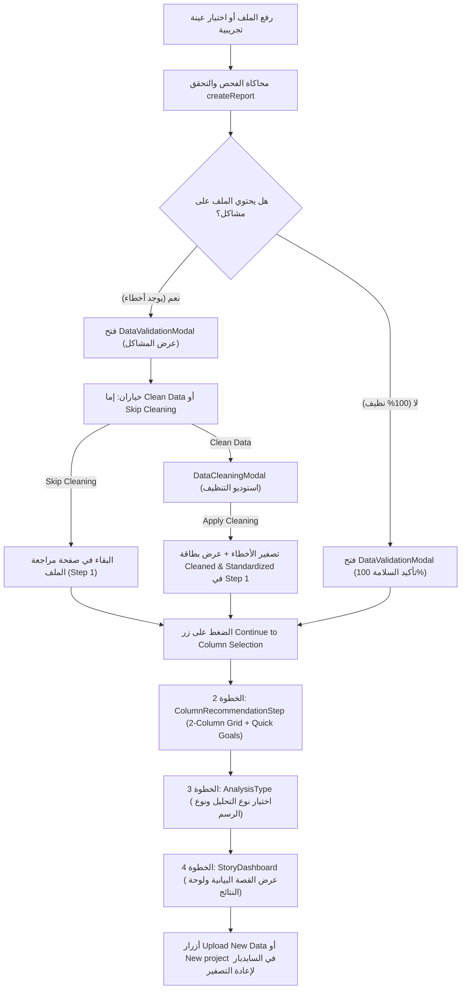
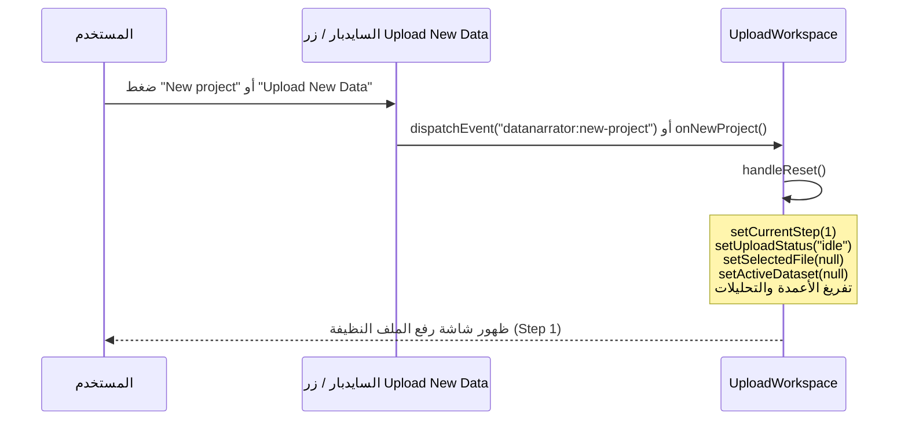

# 📘 توثيق نظام وتدفقات DataNarrator الشامل
> **مرجع معماري وتفصيلي لحالات النظام، تدفق البيانات، وإعدادات المكونات (حماية ضد التراجع في الكود)**

---

## 📑 فهرس المحتويات
1. [نظرة عامة على النظام والمعمارية](#1-نظرة-عامة-على-النظام-والمعمارية)
2. [دورة حياة الخطوات وتدفق العمل (Workflow Lifecycle)](#2-دورة-حياة-الخطوات-وتدفق-العمل-workflow-lifecycle)
3. [الملفات الأساسية ووظائفها التفصيلية](#3-الملفات-الأساسية-ووظائفها-التفصيلية)
4. [منطق التحقق والتنظيف (Validation & Data Cleaning)](#4-منطق-التحقق-والتنظيف-validation--data-cleaning)
5. [آلية تصفير وبدء مشروع جديد (Global Reset & New Project)](#5-آلية-تصفير-وبدء-مشروع-جديد-global-reset--new-project)
6. [قائمة التنبيهات وقواعد منع التعارض (Regression Checklist)](#6-قائمة-التنبيهات-وقواعد-منع-التعارض-regression-checklist)

---

## 1. نظرة عامة على النظام والمعمارية

منصة **DataNarrator** هي تطبيق مبني على:
- **Frontend Framework**: Next.js (App Router) + React + TypeScript.
- **Styling**: Tailwind CSS مع دعم كامل ومزدوج للـ Light Mode و Dark Mode (`dark:` classes).
- **Backend Services**: Python FastAPI (خدمات المصادقة، التحليل، وإعدادات العملات).
- **State Pattern**: إدارة الحالة المحلية عبر React Hooks (`useState`, `useEffect`, `useRef`) مع أحداث موجهة (`CustomEvent`) للتواصل بين المكونات غير المتصلة شجرياً (مثل السايدبار وواجهة الرفع).



---

## 2. دورة حياة الخطوات وتدفق العمل (Workflow Lifecycle)

يتم التحكم بالخطوات من خلال المتغير `currentStep` (من 1 إلى 4) في المكون الرئيسي [`UploadWorkspace`](components/upload-workspace.tsx):

| رقم الخطوة | المكون المسؤول | الوظيفة الأساسية |
| :--- | :--- | :--- |
| **Step 1** | `UploadWorkspace` + `DropzoneView` / `SuccessCard` | رفع الملف، فحص جودته، معالجة القيم المفقودة والتنسيقات والتكرار. |
| **Step 2** | `ColumnRecommendationStep` | اختيار الأعمدة المستهدفة للتحليل عبر شبكة ثنائية وأهداف سريعة كرتية. |
| **Step 3** | `AnalysisType` + `resolveDynamicChartRecommendation` | اختيار المنهج التحليلي (اتجاهات، مقارنات، ارتباط، إلخ) وتحديد نوع الرسم البياني. |
| **Step 4** | `StoryDashboard` | توليد القصة التفاعلية والرسومات الإحصائية مع خيارات التصدير والمشاركة ورفع داتا جديدة. |

---

## 3. الملفات الأساسية ووظائفها التفصيلية

### 1. `components/upload-workspace.tsx`
- **الحالة الأساسية**:
  - `currentStep`: رقم الخطوة الحالية.
  - `activeDataset`: كائن بيانات الملف النشط من نوع `DatasetMeta`.
  - `validationReport`: يحتوي على `missingValues`, `formatErrors`, `duplicateRows`, و `isCleaned`.
  - `isValidationOpen` و `isCleaningOpen`: نوافذ الفحص والتنظيف.
- **الدوال الجوهرية**:
  - `createReport(name)`: تنشئ تقرير الفحص حسب اسم الملف:
    - `Global_Sales_Q3_Performance.csv` -> بيانات غير نظيفة لتجربة التنظيف.
    - `Customer_Retention_Cohort.xlsx` -> بيانات غير نظيفة لتجربة التنظيف.
    - `Marketing_Campaign_ROI_2025.csv` -> **بيانات نظيفة 100%** (`missingValues: []`, `formatErrors: []`, `duplicateRows: []`, `isCleaned: true`).
  - `handleApplyCleaning(decisions)`: تطبق قرارات التنظيف، تعيد تسمية الأعمدة أو دمجها، **وتصفر مصفوفات الأخطاء** وتضبط `isCleaned: true`.
  - `handleReset()`: **تصفير شامل**:
    - `setCurrentStep(1)`
    - `setUploadStatus("idle")`
    - تفريغ الملف والأعمدة وأنواع التحليل والتنبيهات.
    - الاستماع لحدث `datanarrator:new-project`.
- **مكون `SuccessCard`**:
  - `hasIssues = !report?.isCleaned && Boolean(report?.missingValues?.length || report?.formatErrors?.length || report?.duplicateRows?.length)`.
  - إذا كان `report?.isCleaned === true`:
    - يظهر بادج أخضر: `Cleaned & Standardized`.
    - يختفي صندوق الأخطاء البرتقالي/الأحمر تماماً.
    - تظهر بطاقة التأكيد الخضراء مع ملخص التنظيف وزر مراجعة القواعد.
    - يظهر زر وحيد: `Continue to Column Selection`.

### 2. `components/data-validation-modal.tsx`
- **المكون الأول `DataValidationModal` (نافذة الفحص)**:
  - يستقبل `isOpen`, `report`, `datasetMeta`, `onClose`, `onProceed`, `onSkip`, `onOpenCleaning`.
  - في حال وجود مشاكل (`hasIssues = true`):
    - ترويسة برتقالية: `Data Quality & Detected Issues`.
    - زر `Clean Data` لفتح استوديو التنظيف.
    - زر **`Skip Cleaning`**: مربوط بـ `onSkip || onClose` -> **يغلق المودال ويُبقي المستخدم في صفحة الرفع (Step 1)** دون نقله إجبارياً للخطوة 2!
  - في حال كانت البيانات نظيفة (`!hasIssues`):
    - ترويسة خضراء: `Dataset Verified • 100% Clean` مع أيقونة صح خضراء وبادج `All Checks Passed`.
    - بطاقة `CleanAlert` تحتوي على 3 بطاقات تأكيد: `0 Empty Cells`, `Uniform Formats`, `0 Duplicates`.
    - زر: `Continue to Column Selection`.
- **المكون الثاني `DataCleaningModal` (استوديو التنظيف)**:
  - **خيارات توحيد القيم المفقودة (Missing Values)**:
    - `Null`
    - `None`
    - `NaN` -> مزود بتلميح عند وقوف الفأرة: `title="Not a Number"`.
    - `NaT` -> مزود بتلميح عند وقوف الفأرة: `title="Not a Time"`.
    - `Custom` -> حقل إدخال يدوي يكتب فيه المستخدم أي قيمة خاصة.
    - زر `Set All` يطبق الخيار على كافة الأعمدة دفعة واحدة.

### 3. `components/column-recommendation-step.tsx`
- **الأمثلة السريعة (Quick Examples)**:
  - معروضة كشبكة بطاقات واضحة (`grid-cols-1 sm:grid-cols-3 gap-3`).
  - تحتوي على عنوان بارز مع إيموجي ومؤشر اختيار دائري أزرق عند التحديد.
  - نص توضيحي مبسط (`hint`) يشرح الفائدة بلغة مفهومة.
  - **لا تحتوي على وسوم الأعمدة بالداخل** للحفاظ على بساطة الواجهة ونظافتها.
- **قائمة الأعمدة (Columns List)**:
  - معروضة في **شبكة ثنائية مدمجة** (`grid grid-cols-1 sm:grid-cols-2 gap-2`) لتقليص الارتفاع الرأسي بنسبة 50%.
  - محاطة بحاوية تمرير ذات حد أقصى للارتفاع: `max-h-[300px] overflow-y-auto pr-1` لمنع تمدد الصفحة عمودياً.
  - كرت العمود `ColumnCard` يحتوي على: Checkbox + اسم العمود + بادج `Recommended` + الوصف المختصر.

### 4. `components/story-dashboard.tsx`
- **الترويسة العلوية `TopNavigation`**:
  - زر `Back to Analytical Approach`.
  - **زر `Upload New Data`** (`<UploadCloud />`): ينفذ دالة `onNewProject` التي تم تمريرها من `UploadWorkspace` ليرجع المستخدم فوراً للخطوة الأولى لرفع ملف جديد.
  - كرت اسم الملف وعدد الصفوف وبادج `AI Generated Narrative`.
  - أزرار `Share` و `Export`.

### 5. `components/app-sidebar.tsx`
- زر **`New project`**:
  - عند النقر عليه، ينفذ الدالة:
    ```ts
    const handleClick = () => {
      if (item.label.toLowerCase().includes("new project")) {
        window.dispatchEvent(new CustomEvent("datanarrator:new-project"))
      }
    }
    ```
  - يستقبل `UploadWorkspace` هذا الحدث ويقوم بتصفير المشروع بالكامل والرجوع للخطوة 1، حتى لو كان المسار الحالي هو `/upload` بالفعل.

### 6. `components/settings-workspace.tsx` & `app/settings/page.tsx`
- خلفية الموقع الزخرفية: `<DecorativeBackground />` مع تماثل الألوان في اللايت والدارك مود.
- بطاقات غير شفافة تماماً (Opaque Cards بدون `backdrop-blur` أو شفافية) لتطابق بطاقات الصفحة الرئيسية.
- العملات الست المعتمدة المتطابقة مع الباك إند: `SAR`, `USD`, `EUR`, `GBP`, `AED`, `KWD`.

---

## 4. منطق التحقق والتنظيف (Validation & Data Cleaning)

### كود فحص وجود المشاكل في المكونات:
```ts
// قاعدة التحقق الصحيحة (يجب أن تأخذ بعين الاعتبار حالة ما بعد التنظيف)
const hasIssues = !report?.isCleaned && Boolean(
  report?.missingValues?.length ||
  report?.formatErrors?.length ||
  report?.duplicateRows?.length
)
```

### خيارات الـ Missing Values المعتمدة:
```ts
const PRESET_OPTIONS = [
  { value: "Null", label: "Null", tooltip: "Null" },
  { value: "None", label: "None", tooltip: "None" },
  { value: "NaN", label: "NaN", tooltip: "Not a Number" },
  { value: "NaT", label: "NaT", tooltip: "Not a Time" },
]
```

---

## 5. آلية تصفير وبدء مشروع جديد (Global Reset & New Project)



---

## 6. قائمة التنبيهات وقواعد منع التعارض (Regression Checklist)

عند إجراء أي تعديل مستقبلي، تأكد من عدم كسر أي من النقاط التالية:

- [ ] **عدم تجاوز خطوة الرفع عند الضغط على Skip**: يجب أن يظل زر `Skip Cleaning` يستدعي `onSkip` التي تغلق النافذة وتبقي المستخدم في Step 1، دون استدعاء `setCurrentStep(2)`.
- [ ] **اختفاء صندوق الأخطاء بعد التنظيف**: في `UploadSuccessCard` يجب دائماً فحص `!report?.isCleaned` حتى تختفي كروت الأخطاء بعد الضغط على `Apply Cleaning`.
- [ ] **تصفير مصفوفات الأخطاء في `handleApplyCleaning`**: يجب دائماً إسناد `missingValues: []`, `formatErrors: []`, `duplicateRows: []` عند تطبيق التنظيف.
- [ ] **حفظ مساحة صفحة اختيار الأعمدة (Step 2)**: الحفاظ على `grid-cols-2` لقائمة الأعمدة مع `max-h-[300px]` وسكرول داخلي، وعدم إرجاعها كقائمة رأسية مفرودة طويلة.
- [ ] **تلميحات وتسميات الـ Missing Values**: الحفاظ على Casing الخيارات (`Null`, `None`, `NaN`, `NaT`) وتلميحات `title="Not a Number"` و `title="Not a Time"`.
- [ ] **ملف الاختبار النظيف**: الحفاظ على ملف `Marketing_Campaign_ROI_2025.csv` في `createReport` كمصفوفات فارغة لتمكين اختبار تجربة المستخدم مع الملفات السليمة 100%.
- [ ] **تصفير `handleReset`**: يجب أن تحتوي دائماً على `setCurrentStep(1)` لضمان عودة المستخدم للشاشة الأولى عند الضغط على "New project".
